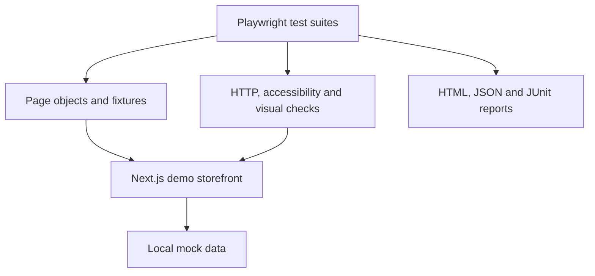

# Geeks Shop

[](https://github.com/ViviDickens/geeks-shop/actions/workflows/playwright.yml)
[](https://github.com/ViviDickens/geeks-shop/actions/workflows/deploy.yml)

**A controlled e-commerce test environment and Playwright automation portfolio project.**

Geeks Shop combines a demo storefront with an integrated QA automation suite. It provides a reproducible target for testing web application behavior without depending on a third-party storefront or a real payment or authentication service.

[Live demo (GitHub Pages)](https://vividickens.github.io/geeks-shop/) · [Test documentation](README-TESTS.md) · [CI workflow runs](https://github.com/ViviDickens/geeks-shop/actions)

## Technology stack

| Technology | Role |
| --- | --- |
| Next.js 15.3.2 / React 19 | Demo storefront, App Router and static export |
| TypeScript | Application and test implementation |
| npm | Dependency management with a committed lockfile |
| Playwright Test | Browser automation and HTTP checks |
| axe-playwright | Automated accessibility checks |
| GitHub Actions | CI execution and static site deployment |

## Application and testable flows

| Page | Route | Test targets |
| --- | --- | --- |
| Home | `/` | Hero, featured products, calls to action |
| Catalog | `/products` | Search, category filters, sorting, empty states |
| Product detail | `/products/[id]` | Product information, quantity controls, add to cart |
| Cart | `/cart` | Item management, quantities and totals |
| Login | `/login` | Form validation, mock authentication and error states |

The storefront uses local TypeScript fixtures for products and users. Login is simulated in the browser and stores mock session information in local storage. It is not production authentication.

### Demo credentials

Use the test account displayed on the login page. These are public, synthetic credentials for the demo only; never use real credentials in this environment.

## Test automation architecture



The framework uses reusable page objects for the home, catalog, product detail and cart pages, along with shared fixtures and utilities. Stable `data-testid` attributes support selectors where appropriate.

### Test suites

| Suite | Command | Focus |
| --- | --- | --- |
| Smoke | `npm run test:smoke` | Basic application availability and behavior |
| Navigation | `npm run test:navigation` | Navigation and routing |
| Content | `npm run test:content` | Rendered content |
| API / HTTP | `npm run test:api` | HTTP responses and API-oriented checks |
| Accessibility | `npm run test:a11y` | Automated accessibility checks |
| Visual | `npm run test:visual` | Screenshot comparisons |
| Shadow DOM | `npm run test:shadow-dom` | Shadow DOM-oriented scenarios |

The configured browser projects are Chromium, Firefox and WebKit. The suite also includes an example spec. The presence of a test suite does not imply that all tests currently pass.

## Getting started

Use Node.js 24 (the version configured in CI), npm and Git.

```bash
git clone https://github.com/ViviDickens/geeks-shop.git
cd geeks-shop
npm ci
npm run dev
```

Open [http://localhost:3000](http://localhost:3000).

### Run automated tests

```bash
npx playwright install
npm run test:e2e
```

Playwright starts the local development server automatically when needed. On Linux CI environments, install browser system dependencies with `npx playwright install --with-deps`.

```bash
# Run a single browser project
npx playwright test --project=chromium

# Interactive execution and debugging
npm run test:ui
npm run test:debug

# Open the HTML report after a run
npx playwright show-report
```

### Build the static storefront

```bash
npm run build
```

The production build exports static files to `out/`, with the `/geeks-shop` base path configured for GitHub Pages. Local development uses the root path instead.

## CI/CD and reporting

The [Playwright workflow](.github/workflows/playwright.yml) runs on pushes and pull requests targeting main or develop, on a weekly schedule and on manual dispatch. A browser matrix runs Chromium, Firefox and WebKit separately.

The configured reporters generate HTML, JSON and JUnit results. Screenshots and videos are retained on failure, and traces are captured on the first retry. The workflow uploads reports and test results as artifacts when available.

A separate [deployment workflow](.github/workflows/deploy.yml) builds and publishes the static storefront to GitHub Pages.

## Project structure

```text
geeks-shop/
├── .github/workflows/
│   ├── deploy.yml
│   └── playwright.yml
├── src/
│   ├── app/
│   │   ├── cart/
│   │   ├── login/
│   │   ├── products/
│   │   │   └── [id]/
│   │   ├── globals.css
│   │   ├── layout.tsx
│   │   └── page.tsx
│   ├── components/
│   └── data/
├── tests/
│   ├── a11y/
│   ├── api/
│   ├── content/
│   ├── navigation/
│   ├── pages/
│   ├── shadow-dom/
│   ├── smoke/
│   ├── utils/
│   ├── visual/
│   ├── example.spec.ts
│   └── fixtures.ts
├── next.config.ts
├── playwright.config.ts
├── package.json
├── package-lock.json
├── README-TESTS.md
└── README.md
```

## Known limitations

- The application is a static demo with mock data, not a transactional e-commerce backend.
- No server-side REST API routes are present in the current source tree. Some tests in `tests/api/` still target `/api/products` and need alignment with the static architecture.
- Visual snapshots are platform-specific; the committed Windows baselines may need corresponding Linux baselines for CI.
- Automated accessibility checks do not establish full WCAG compliance.

## Related project

[Charles Dickens Museum — Playwright automation](https://github.com/ViviDickens/charles_dickens_museum) complements this repository with an example of automation against an external website.

## Author

**Viviana Pérez** — SDET | QA Automation Engineer | AI Quality & Security Engineering

[GitHub portfolio](https://github.com/ViviDickens)
